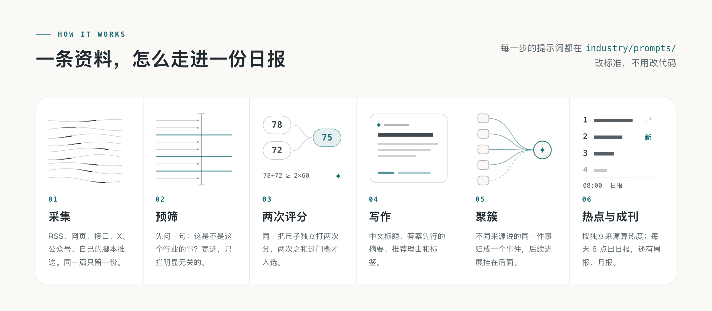

<p align="center">
  <b>热点财知道</b><br>
  <sub>基于 <a href="https://github.com/KKKKhazix/AIHOT">AIHOT</a> 开源引擎改造的财经热点解读站</sub>
</p>

<p align="center">
  <a href="LICENSE"></a>
  
  
  
  <a href="https://github.com/KKKKhazix/AIHOT"></a>
</p>

<p align="center">
  <b>借鉴 AIHOT，改造成财经热点解读。</b><br>
  覆盖 6 大类资产、主题轮动、31 申万一级行业、场外基金与 ETF。
</p>

<p align="center">
  <a href="#这是什么">这是什么</a> ·
  <a href="#相对上游改了什么">相对上游改了什么</a> ·
  <a href="#跑起来">跑起来</a> ·
  <a href="docs/customize.md">改成你的行业</a> ·
  <a href="#它是怎么工作的">它是怎么工作的</a> ·
  <a href="docs/">文档</a>
</p>

<br>

## 这是什么

本仓库 **借鉴 [AIHOT](https://github.com/KKKKhazix/AIHOT)**（每个行业都可以有自己的 AI 热点站的开源引擎），在保留其采集 → 预筛 → 双次评分 → 写作 → 聚簇 → 热点 → 日报/周报/月报全链路的前提下，**改造成面向中国市场的财经热点解读站「热点财知道」**。

引擎能力与上游同源：信源采集、精选评分、事件归组、热度榜、日报成刊、公开 API / RSS / MCP；**财经化改动集中在 `industry/`、`site/` 与部署配置**，便于继续合并上游更新。

### 覆盖范围

| 层级 | 内容 |
|------|------|
| **粗分类**（站内 `industry/taxonomy.ts`） | 宏观与政策 + **6 大类资产**（A股 / 港股 / 美股 / 海外其他 / 黄金 / 债券）+ 综合 |
| **细桶**（消费端规则分桶，47 桶） | 宏观+6 资产、**7 大主题**、**31 申万一级行业**、**场外基金 / ETF** |
| **内容形态** | 政策监管、宏观数据、公司事件、行情异动、产品发行、研报观点、风险事件 |
| **出刊** | 每日日报（规则编排，不烧模型）+ 周报 / 月报总述 |

细桶规则在配套消费端（基金网页 `signals/hot_buckets.py`）按关键词多标签打标；本仓库负责信源、精选、事件与日报。

### 相对上游改了什么

| 区域 | 改动 |
|------|------|
| `industry/` | 财经分类与标签词表、财经评分标准与提示词、财经信源 `sources.json`、门槛 `selection.ts` |
| `site/` | 站名「热点财知道」、文案、品牌、`poweredBy` 保留 AIHOT 署名 |
| `site/models.ts` | 硅基流动免费档 preset（`siliconflow-free` = Qwen2.5-14B），分步降本 |
| 部署 | Docker Compose 五服务；生产可只跑服务器单实例；模型路由用 `*_MODEL` 环境变量 |

**请不要使用 AIHOT 的名字和 Logo 作为本站品牌**；页脚/关于页保留「由 AIHOT 驱动」署名即可。

## 它是怎么工作的

一条资料从信源进来，先判重，再预筛；可能重要的独立打两次分，写好中文标题和摘要，和别的报道聚成事件，算进热度。分数过了门槛、又不是精选里已有新闻的重复，才进精选；日报按规则编出当天要闻，周报、月报再从日报里汇编。每一步的提示词都在 [`industry/prompts/`](industry/prompts/)，改标准不用改代码。详见 [精选与校准](docs/selection.md)。

### 聚簇与热点

同一件事，官网发一篇、媒体发十篇，读者只需要看到一次。不同来源的报道聚成**事件**；热度按事件算：48 小时内每个独立来源只算一次，24 小时减半。

### 降本（本部署实践）

| 阶段 | 做法 |
|------|------|
| Phase1 | 预筛 / 结构 / 归组 / 复核 / 非精选摘要 / 反馈 → 免费 Qwen |
| Phase2 | **score / understand / digest** 也切免费；`LLM_REASONING_TOKENS=0` + 关思考 |
| 结果 | 日常 MIMO ≈ 0，仅周报/翻译 default 兜底 |

分步换模型：`.env` 里 `PREFILTER_MODEL` / `SCORE_MODEL` / … = `siliconflow-free`，或后台「模型与评测」页。

## 你会得到什么

| | |
|---|---|
| **六种信源** | RSS、网页列表、JSON 接口、X 账号、微信公众号，以及脚本推送（`/api/ingest/items`） |
| **精选** | 预筛 + 同一标准独立打两次分 + 分级门槛；提示词与门槛全公开可改；SelectBench 校准 |
| **写作** | 中文标题、摘要、推荐理由；分类标签与新闻事实抽取 |
| **聚簇与热点** | 同事聚事件、事件页综述、按独立来源计热度 |
| **日报 / 周报 / 月报** | 日报规则编排；周报月报模型只写总述与导读 |
| **给 Agent** | RSS、公开 API、MCP、`llms.txt` |
| **后台** | 信源试抓、内容诊断、模型逐步切换、预算熔断、运行告警 |

## 跑起来

需要 [Docker](https://docs.docker.com/get-started/get-docker/)、[Node.js 24](https://nodejs.org/en/download)，以及一个 OpenAI 兼容的模型 API Key（本部署用 MIMO 兜底 + 硅基流动免费档做主力）。

```bash
git clone https://github.com/youngcypress/aihot-fin.git
cd aihot-fin
node scripts/init-env.ts --llm-key <你的模型APIKey>
# 按需改 .env：SF_* 免费模型、*_MODEL 路由、SITE_URL、端口
docker compose up -d --build
# 站点默认 http://localhost:3000 ，后台 /admin
```

国内构建可加：`docker compose build --build-arg NPM_REGISTRY=https://registry.npmmirror.com`。

更完整的部署、更新与安全说明见 [`docs/deploy.md`](docs/deploy.md)；改成自己行业见 [`docs/customize.md`](docs/customize.md)。

## 它是怎么工作的（上游原图）

<p align="center">
  
</p>

（深浅色示意图见 `docs/assets/`。）

## 文档

| 文档 | 内容 |
|------|------|
| [docs/customize.md](docs/customize.md) | 改成另一个行业 |
| [docs/selection.md](docs/selection.md) | 精选标准与门槛校准 |
| [docs/sources.md](docs/sources.md) | 信源规则 |
| [docs/grouping.md](docs/grouping.md) | 事件归组 |
| [docs/deploy.md](docs/deploy.md) | 部署、更新、花多少钱 |
| [docs/architecture.md](docs/architecture.md) | 架构与迁移约定 |
| [AGENTS.md](AGENTS.md) | 给编码 Agent 的仓库规则 |

上游项目与社区：[KKKKhazix/AIHOT](https://github.com/KKKKhazix/AIHOT) · [aihot.news](https://aihot.news)

## 致谢

- **[AIHOT](https://github.com/KKKKhazix/AIHOT)**（[数字生命卡兹克](https://github.com/KKKKhazix)）— 开源引擎与框架，本仓库在其上做财经行业改造，遵循其 MIT License。
- 本仓库仅作学习与自有业务部署；**品牌与运营与上游 AIHOT 站点相互独立**。

## License

[MIT](LICENSE) © 上游 AIHOT 作者及本仓库贡献者。
